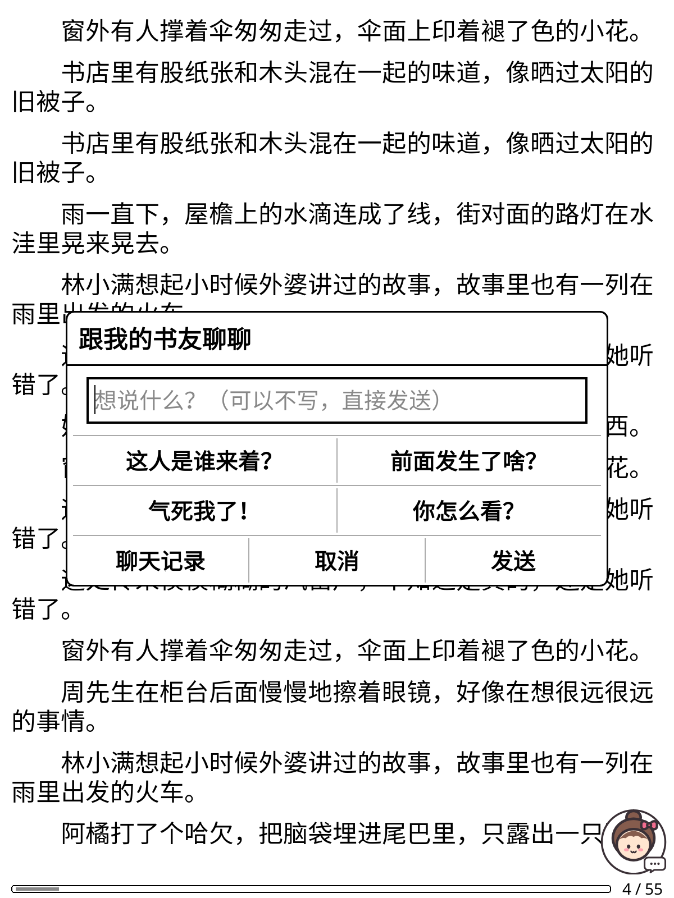
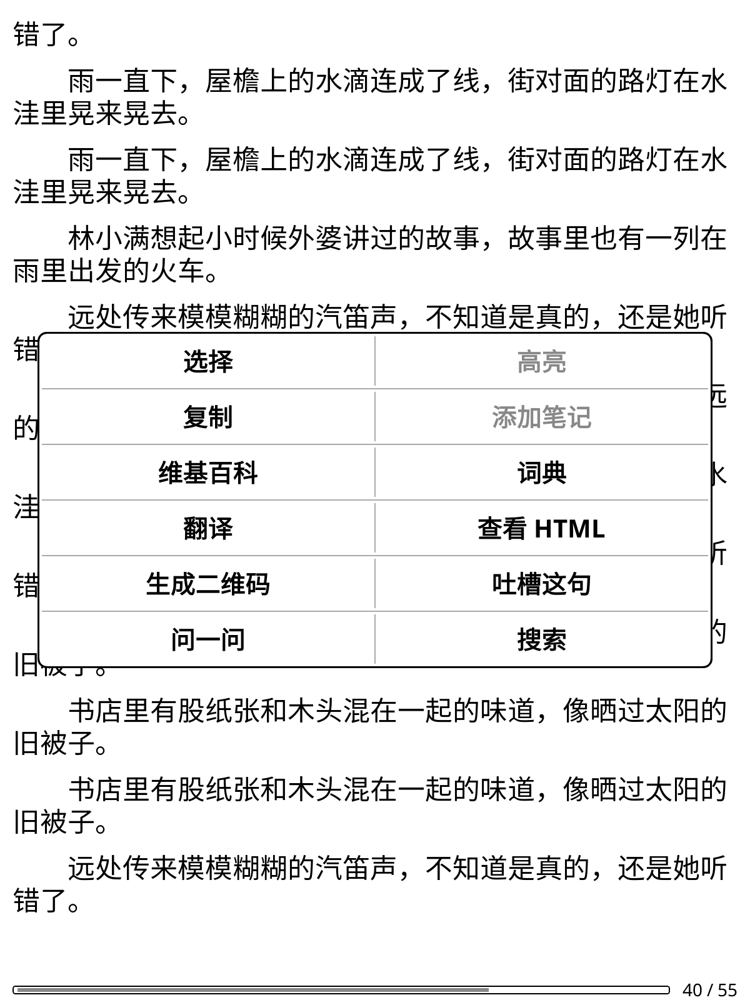

# Reading Buddy · 陪读小伙伴

**[中文](#中文) · [English](#english)**

  
  
  

---

## 中文

一个 [KOReader](https://github.com/koreader/koreader) 插件：给你的墨水屏阅读器（Kobo、Kindle 等）配一个 **AI 陪读朋友**。

它**只看得到你已经读到的地方**，绝不剧透。读的时候想吐槽、有看不懂的地方，随时跟它聊。

### 功能

- **吐槽这句 / 问一问**：长按选中一句话，弹出的菜单里多了这两个按钮。不打字直接发送也可以。
- **右下角陪读小人头**：读书页面右下角有个小女孩头像，点一下就能聊。还有几个快捷句（「这人是谁来着？」「前面发生了啥？」「气死我了！」「你怎么看？」），点一下就发，不用打字。
- **绝不剧透**：
  - 只把「你读到过的最远位置」之前的文字发给 AI，后面的一个字都不发；
  - 读过的较早部分会先做成简短的「前情提要」（每 1 万字一段），最近读的 3000～13000 字给原文；
  - 你问到某个人名、词（选中它，或者在问题里用「」括起来），会去前文里找它出现过的地方一起发给 AI，方便回答「这个人前面出现过吗」。
- **四种陪读性格**：毒舌搭子（双马尾）、温柔解答（长发）、考据党（眼镜）、自定义（丸子头）。
- **任意 AI 服务商、任意模型**：Claude（Anthropic）、ChatGPT（OpenAI）、Gemini、DeepSeek、通义千问、Kimi、智谱 GLM、豆包、OpenRouter，以及任何兼容 OpenAI 格式的接口（包括局域网里的 Ollama 等本地模型）。可以从服务商拉取模型列表。
- **中文 / 英文界面**：跟着 KOReader 的语言设置走。

### 安装

1. 先在阅读器上装好 KOReader（[Kobo 安装教程](https://github.com/koreader/koreader/wiki/Installation-on-Kobo-devices) · [Kindle 安装教程](https://github.com/koreader/koreader/wiki/Installation-on-Kindle-devices)，Kindle 需要先越狱）。
2. 到 [Releases](../../releases) 下载最新的 `readingbuddy.koplugin-vX.X.X.zip`，解压。
3. 用数据线连上阅读器，把 **`readingbuddy.koplugin` 整个文件夹**拷进 KOReader 的 `plugins` 文件夹：
   - Kobo：`.adds/koreader/plugins/`（`.adds` 是隐藏文件夹，Mac 上在访达里按 ⌘ + Shift + . 显示）
   - Kindle：`koreader/plugins/`
4. 完全退出 KOReader，再重新打开。

### 设置 AI

1. **先打开一本书**（Reading Buddy 只在看书时的菜单里出现）。
2. 点屏幕上方调出菜单 → **扳手图标** → **Reading Buddy** → **AI 设置**。
3. 选服务商，填 API Key，选模型，然后点「测试连接」。

**不想在墨水屏上打长长的 Key？** 在电脑上建一个纯文本文件 `readingbuddy-key.txt`，里面只写 Key，拷进阅读器的 `koreader` 文件夹（Kobo 是 `.adds/koreader/`），再在插件里点「API Key → 从文件读取」。读完后插件会问你要不要把这个文件删掉。

> ⚠️ **API Key 以明文保存在阅读器的 `koreader/settings.reader.lua` 里。** 不要把这个文件分享给别人。

### 隐私

- 只会把你读到的位置之前的书中文字，和你发的聊天内容，发给**你自己选的** AI 服务商。插件作者收不到任何东西。
- 前情提要和聊天记录存在这本书旁边的 `.sdr` 文件夹里（KOReader 存阅读进度的地方）。

### 已知限制

- 只支持可以重排的书（epub、txt、fb2、mobi 等）。PDF、漫画不行。
- 墨水屏上不显示 Markdown。
- 从一本长书的中间开始第一次聊天，需要先补做很多段前情提要，会比较慢，也会多花一点额度。
- 如果从目录往后跳着翻过，AI 会以为那些也读过了。可以在「这本书的设置 → 把读到的最远位置改成当前页」改回来。

### 推荐搭配

墨水屏上打中文：[pinyinime.koplugin](https://github.com/Merpyzf/pinyinime.koplugin)（另一位作者做的拼音输入法插件，支持词组和双拼）。

### 测试环境

在电脑版 KOReader v2026.07 上完整测试过；Kobo 实机上能正常安装和使用。

---

## English

A [KOReader](https://github.com/koreader/koreader) plugin that gives your e-reader (Kobo, Kindle, ...) an **AI reading buddy**.

It **only knows what you've read so far**, so it never spoils anything. Rant about a line or ask a question whenever you like.

### Features

- **Rant / Ask**: long-press to highlight a line, and two new buttons appear in the highlight menu. You can send without typing anything.
- **Buddy icon in the corner**: tap the little girl in the bottom-right corner of the page to chat. One-tap quick phrases mean no typing needed.
- **No spoilers**:
  - only text before your *furthest-read position* is sent to the AI;
  - earlier parts are sent as short summaries (one per 10,000 characters), and the most recent 3,000-13,000 characters are sent as-is;
  - names or words you ask about (highlighted, or quoted in your question) are looked up in the earlier text, so the AI can answer "did this character show up before?"
- **Four personalities**: Snarky Pal, Gentle Guide, Detail Detective, or write your own.
- **Any AI provider, any model**: Claude (Anthropic), ChatGPT (OpenAI), Gemini, DeepSeek, Qwen, Kimi, Zhipu GLM, Doubao, OpenRouter, or any OpenAI-compatible API (including a local Ollama on your Wi-Fi). It can fetch the model list from your provider.
- **Chinese / English UI**: follows KOReader's language setting.

### Install

1. Install KOReader on your device ([Kobo guide](https://github.com/koreader/koreader/wiki/Installation-on-Kobo-devices) · [Kindle guide](https://github.com/koreader/koreader/wiki/Installation-on-Kindle-devices); Kindle needs a jailbreak).
2. Download the latest `readingbuddy.koplugin-vX.X.X.zip` from [Releases](../../releases) and unzip it.
3. Copy the **whole `readingbuddy.koplugin` folder** into KOReader's `plugins` folder:
   - Kobo: `.adds/koreader/plugins/` (`.adds` is hidden; on a Mac press Cmd + Shift + . in Finder)
   - Kindle: `koreader/plugins/`
4. Quit KOReader completely and open it again.

### Set up the AI

1. **Open a book first**. Reading Buddy only appears in the menu while reading.
2. Tap the top of the screen → **wrench (tools) tab** → **Reading Buddy** → **AI settings**.
3. Pick a provider, enter your API key, choose a model, then tap "Test connection".

**Don't want to type a long key on e-ink?** Create a plain text file `readingbuddy-key.txt` containing only the key, copy it into the `koreader` folder on your device (`.adds/koreader/` on Kobo), then tap "API key → From file". The plugin offers to delete the file afterwards.

> ⚠️ **Your API key is stored as plain text in `koreader/settings.reader.lua` on the device.** Don't share that file.

### Privacy

- Only the book text before your reading position, plus your chat messages, are sent, and only to **the AI provider you chose**. The plugin author receives nothing.
- Summaries and chat history are stored in the book's `.sdr` sidecar folder.

### Known limitations

- Reflowable books only (epub, txt, fb2, mobi, ...). No PDF or comics.
- Markdown isn't rendered on e-ink.
- The first chat in the middle of a long book needs many summaries first, so it's slow and uses more API credit.
- If you skip ahead via the table of contents, the AI assumes you've read it. Use "This book → Set furthest read to this page" to fix that.

---

## License

[MIT](LICENSE) © 2026 Rei

Ported from the iPhone app *一起看书啦 (Read Together)*.
